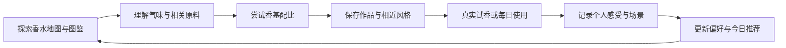

# 香水图鉴应用：产品大纲 v0.1

日期：2026-11-07  
状态：供讨论的产品大纲；尚未进入 PRD、界面设计或应用构建。  
工作目录：`D:\Projects\香水`

## 1. 产品定位

一个把香水图鉴、气味科学、虚拟调香和个人使用记录连接起来的应用，让用户既能找到喜欢的香水，也能理解自己为什么喜欢，以及配比变化可能带来的气味变化。

核心主张：**让气味可以被探索、被解释、被比较，并通过真实体验不断校准。**

现有产品中，PERFUMIST 已提供基于喜好的香水推荐，Fragplace 已介绍结合香水柜、日记、天气和场合的助手。因此本项目值得突出的是“可解释的气味与原料关联 + 配比试验 + 个人实闻校准”，而不是把日记或天气推荐本身当作独有功能。本轮只核查这些产品的官方介绍，没有实测完整体验。[PERFUMIST](https://perfumist.fr/)、[Fragplace Assistant](https://fragplace.com/en/assistant)

长期目标是覆盖主流品牌的香水图鉴。首版先做有限、可核验的数据集，打通“认识—搭配—使用—反馈”的完整体验。

工作假设：中文优先、移动端优先的响应式网页应用，兼顾桌面探索；先服务普通香水爱好者与 DIY 体验者。平台、品牌范围、收费方式尚未确定。

## 2. 已确认的需求与历史依据

### 2.1 本次明确提出的需求

- 收录主流品牌香水，形成可探索的图鉴与地图。
- 关联化学原理，解释香型与原料、分子的关系，并建立量化表达。
- 借鉴日本 DIY 调香经历，让用户尝试配比变化，理解气味、相近香水、偏好人群及使用场合。
- 记录每日用香，并逐步结合天气、日程提供推荐。
- 按“大纲 → 产品文档 → 构建”的顺序推进。

### 2.2 已回查的日本 DIY 案例

历史聊天及原始配方卡显示：2026-10-06，福冈 MY ONLY FRAGRANCE，作品名 Jojo，成品标注 50 mL、EDP。

| 店内基底编号 | 配方卡用量 | 三款已记录基底之间的体积比例 |
|---|---:|---:|
| 12 | 4.6 mL | 46% |
| 19 | 3.3 mL | 33% |
| 61 | 2.1 mL | 21% |

三款用量合计 10.0 mL。这里的比例只描述三款店内基底之间的关系，不能推导各基底内部的分子组成、质量百分比或成品的纯香料浓度。编号对应的名称、香调与当前版本尚未重新核验。

用户描述成品有木质调和花香；同行家人觉得有蜂蜜般的甜腻感。这是一条具体的个人体验，不能据此断定含有蜂蜜原料，也不能直接推出用户长期喜欢或讨厌甜香。

另一条相关历史反馈是用户追问推荐“依据是什么”，并要求参考收礼者实际提过的偏好。因此，推荐需要显示证据，区分本人偏好、他人偏好与创作联想。

产品启发：支持保存原始配方、保留不同评价者的感受、对比预期与实闻，并允许用户纠正系统描述。该案例默认属于私人资料，不作为公开演示内容。

历史证据索引：ChatGPT 聊天 ID `6ac469e4-5cf0-83ea-8ff0-731382f62935`、`6ac49f98-baf4-83ea-b6da-b338eb880400`；后者原始附件 `1000245634.jpg` 已目视核验。本轮未找到所提 vibe coding 香水地图的名称或链接，不将其他产品认定为原参考。

## 3. 用户体验主线

应用需要同时支持两种入口：想探索时进入图鉴和调香台；准备出门时直接进入“今天用什么”。化学信息逐层展开，普通用户无需先掌握专业术语。

## 4. 功能大纲

| 模块 | 用户要解决的问题 | 主要能力 | 第一版重点 |
|---|---|---|---|
| 香水图鉴与地图 | 这是什么味道？和我喜欢的香水有什么关系？ | 品牌、产品版本、香调、风格、筛选、并排比较、相近风格导航 | 精选条目、可解释的地图、搜索与收藏 |
| 气味与分子图鉴 | 为什么会有这种气味？ | 香调—原料—分子的多对多关联，化学资料、代表气味、来源 | 少量可信原料卡和关联解释 |
| 虚拟调香台 | 改变比例后可能有什么不同？ | 选香基、调比例、查看画像变化、保存版本、比较作品 | 有限教学香基的配比探索 |
| 我的香水柜 | 我有哪些、试过哪些、还想试什么？ | 拥有、试过、想试、喜欢、不喜欢；保存 DIY 作品 | 为记录和推荐提供个人候选集 |
| 用香日记 | 今天用了什么，实际感觉如何？ | 香水、时间、用量、场景、感受、个人评分、后续补记 | 快速记录，支持多次使用与不同评价者 |
| 今日推荐 | 今天选哪一款更合适？ | 个人偏好、香水柜、天气、活动、空间条件、推荐解释 | 手动场景与天气输入，优先推荐已拥有香水 |

页面结构建议：**今日 / 探索 / 调香台 / 我的**。探索内连接香水与分子知识；“我的”内聚合香水柜、配方和日记。页面命名与布局留到 PRD、原型阶段细化。

### 4.1 香水图鉴与地图

每款产品区分品牌、系列、具体版本、EDT/EDP 等浓度标识；同名不同版本独立记录。配方改版、地区差异、上市年份只有在有依据时填写。

图鉴展示品牌公开香调、气味标签、来源与核验日期、个人评价、相近风格及不同点。官方描述、编辑性标注和用户评价分开展示。

地图首先表达气味关系，可以从清晰的香型分区开始，再增加连续的感官空间。地图距离需要说明基于哪些标签或评分；不能把视觉上的接近称为真实分子距离。二维坐标是导航视图，不涵盖全部嗅觉差异。

“相似香水”展示共同点和区别，例如都偏木质，但一款更干燥，另一款更甜。未经实闻验证，不显示“闻起来相同 93%”之类精确结论。

### 4.2 气味科学与量化

将用户所说的“化学因子”拆成三个互相关联的层面：

| 层面 | 量化或记录方式 | 能回答的问题 | 不能据此推导的内容 |
|---|---|---|---|
| 化学与原料层 | CAS、结构、分子式、分子量、带测试条件的蒸气压、商品规格等 | 原料是什么，具有哪些已知性质 | 品牌香水的未公开配方、用户必然感受 |
| 感官层 | 香气类别多标签；甜感、粉感、清新感、温暖感、存在感等独立评分 | 气味体验如何描述和比较 | 评分等于化学含量，或所有人感受相同 |
| 使用与个人层 | 使用次数、个人评分、场景、天气、观察到的变化、喜欢与排斥的侧面 | 本人在什么条件下喜欢什么 | 由少量记录直接证明因果或普遍规律 |

感官评分初步可用 0–5 级，但必须有统一说明，并保留“未知”。没有闻香数据时，品牌香调只能映射到标签；如增加编辑评分，应显著注明来源与方法，不能伪装成测量结果。各感官轴独立评分，不要求总和为 100%。

原料类型至少区分：单体分子、异构体或商品混合物、天然复合原料、预调香基。一个香型可由多种原料形成，一个原料也可同时具有多个气味侧面。

可用于首批原料卡的例子：

- **芳樟醇 Linalool**：供应商描述有花香、草本、薰衣草侧面，适合说明一种分子可以关联多个气味标签。[BASF 技术资料](https://download.basf.com/p1/EN_StaticDocuments_5926/en/Technical_Information_Linalool)
- **HEDIONE®**：通透茉莉与柑橘清新侧面，适合说明花香存在感、扩散表现和主观浓烈度是不同维度；保留商品规格信息。[dsm-firmenich 原料资料](https://studio.dsm-firmenich.com/product/hedioner-pe-964898)
- **Iso E Super®**：木质、琥珀及柔和质感侧面，属于需保留异构体信息的商品原料，适合说明木质风格不是单一化学因子。[IFF 原料资料](https://www.iff.com/scent/ingredients-compendium/iso-e-super/)

这些是代表原料，不意味着所有花香或木质香水都含有它们。产品里必须区分“已确认含有”与“可构成类似气味的原料”。

### 4.3 虚拟调香台

首版借鉴日本店内选择复合香基的体验，先提供少量定义清楚的教学香基。用户选择 2–4 种，调整相对比例，保存并比较版本。

输出分成五部分：

1. **画像变化**：哪些标签或教学评分发生变化。
2. **通俗描述**：例如“木质感更突出，花香从主体变成点缀”；无验证时标为模型预计。
3. **相近风格**：图鉴中哪些香水在描述上接近，以及明显区别。
4. **偏好与场合**：适合偏好什么气味、希望呈现什么感觉，以及哪些使用场景值得尝试。
5. **证据与待验证项**：来自标签模型、闻香记录还是实测资料。

“复刻”分成两种目标：

- **重建自己的调配记录**：保留原料身份、版本、用量与步骤；具备相同原料时帮助重做。你的日本配方可先完成记录重建，但在编号含义和基底画像核实前不预测它的准确气味。
- **向某款香水的风格靠近**：把产品当作气味参考，调整教学香基并说明相近侧面；不声称还原商业秘方。

首版滑杆默认表示教学香基的相对份数，不是成品可上肤配方。真实记录可以保存 mL 等原始单位，但不把不同单位、稀释度和规格静默混算。成品叠喷与原料混配也要作为不同模式，首版先不合并。

科学边界：混合气味存在抑制等非线性作用，也存在个体差异，不能保证按比例线性叠加。线性画像可作为透明的教学近似；未经实验不能声称已模拟完整嗅觉。[混合嗅觉人体研究](https://pmc.ncbi.nlm.nih.gov/articles/PMC10394640/)

时间变化首版用开场、过渡、尾韵的描述或实际补记表达，不输出无依据的精确留香小时、扩散半径。皮肤上的挥发与气相浓度变化需要实测条件支持。[皮肤香料挥发研究](https://pubmed.ncbi.nlm.nih.gov/19250472/)

如果后续扩展为真实配方工具，再补充原料规格、稀释度、最终产品质量百分比、用途及安全评估。教学比例不直接导出为可使用的实体配方。[IFRA 官方说明](https://ifrafragrance.org/initiatives-positions/safe-use-fragrance-science/ifra-standards)

### 4.4 每日记录与推荐

日记先保证快速记下“用了什么、什么时候、感觉如何”。喷数、部位、天气、场景和延时反馈为可选信息；不强迫用户每次填写完整问卷。

“我觉得”和“别人觉得”分别保留。例如同一配方可以同时保留用户的木质花香描述与家人的蜂蜜甜腻描述，不把两条意见直接平均成统一真相。

推荐流程：从香水柜选候选 → 考虑已确认喜欢与排斥的气味 → 结合当天场景与天气 → 给出少量建议、理由和可调整因素 → 接收实际反馈。

示例文案，仅用于说明交互：“今天以室内开会为主。你以前在类似场景觉得这款存在感合适，而且你已经拥有它。”如果缺少个人证据，明确写成通用场景建议。

天气与场合规则先作为可被用户修改的经验策略，不把“气温高所以必然适合柑橘”当作化学定律。“适合什么人”优先表达气味偏好、期望风格和使用需求，不由性别、职业或人格标签决定。

首版手动选择城市天气与活动标签即可。后续再在用户授权下接入天气服务和日历；日程分析只需必要的场景信息，不需要默认保存完整事件正文。允许推荐当天不用香水。

## 5. 数据与知识组织

核心对象建议包括：香水产品版本、气味描述词、原料/香基、化学实体、来源证据、配方版本、使用记录、偏好记录与场景。

关键关联包括：产品具有某香调；某原料被描述为某气味；原料包含某化学实体；配方使用某原料；某用户在某场景报告某感受。不同关系不能互相替代。

所有关键结论尽量关联来源、日期、适用条件与证据类型：

- **来源确认**：品牌或供应商直接提供的信息。
- **研究支持**：论文在特定实验条件下得到的结果。
- **编辑或模型推测**：标签映射、教学估计、场景规则。
- **个人记录**：某人在某次使用中的实际反馈。

缺失信息保留为空；来源矛盾保留出处，不由语言模型自动补齐。品牌官网、原料技术资料、研究资料、用户记录分别承担适合的任务。

商品图片、描述、数据库和 API 的复用权限需要单独核实。公开可浏览不等于可整库复制。首批内容以人工核验的简短事实、自己的分类描述及可追溯链接为主。

数据路线的两个具体例子：CHANEL 的产品页将香调与成分表分别展示，但没有给出各香料配比；Fragrances of the World 提供数据库和 API 入口，实际复用仍需按其协议取得相应许可。因此，品牌介绍用于产品事实，分子图鉴使用原料来源，批量目录另行确认授权。[CHANEL 产品页](https://www.chanel.com/us/fragrance/p/107360/bleu-de-chanel-eau-de-parfum-spray/)、[Fragrances of the World 协议](https://fragrancesoftheworld.info/Download/Legal.pdf)

AI 的初期角色是解释已知资料、整理用户描述、辅助检索。数值计算、比例校验、数据来源和推荐排序由可审查的规则承担，避免语言模型凭空补分子或编品牌配方。

Principal Odor Map 等研究提供分子气味表示的研究方向，但单分子实验结果不能直接作为复杂商业香水模拟的准确性证明。后续是否采用，需确认数据与模型许可、适用范围和实际效果。[Science 原论文](https://pubmed.ncbi.nlm.nih.gov/37651511/)

混合物表征也已有专门研究，可列入技术探索，但不能用论文名称替代本应用的验证。[POMMix 原始研究预印本](https://arxiv.org/abs/2501.16271)

## 6. 第一版范围建议

以下均为规划规模，不是已收录或已获得授权的数据：

| 内容 | 建议规模或范围 |
|---|---|
| 品牌与香水 | 8–12 个品牌，60–100 个具体香水版本；优先用户熟悉、气味覆盖有代表性且资料可核验的产品 |
| 原料知识 | 20–30 张原料卡，覆盖多个香气侧面；分子与商品原料类型明确 |
| 虚拟调香 | 8–12 个有明确标签和说明的教学香基；支持保存、改配比、版本对比 |
| 个人功能 | 香水柜、喜欢/不喜欢、用香日记、DIY 配方记录 |
| 推荐 | 规则透明的基础推荐，手动天气/场景；优先已有香水 |
| 平台 | 移动端优先网页；具体技术栈、账号与同步方案留待 PRD |

候选品牌池可从 CHANEL、Dior、Hermès、Guerlain、Tom Ford、Jo Malone London、Diptyque、Byredo、Le Labo、Maison Margiela、Penhaligon’s、Kilian 中选定。此清单只是产品覆盖提案，不表示已核验每个品牌的全部产品或素材许可。

首版先不承诺：全网全量香水数据库、任意商业香水的精确复刻、真实分子级混香引擎、实际配方安全判定、自动日历接入、社区与商城。后续扩展由用户价值和数据条件决定。

## 7. 推进顺序与验收方式

| 阶段 | 交付物 | 验收重点 |
|---|---|---|
| 1. 产品大纲（本轮） | 定位、功能关系、科学边界、首版范围 | 需求均有归属；事实、提案和待确认项清楚 |
| 2. PRD | 用户故事、关键流程、页面结构、字段、规则、异常状态、权限与验收用例 | 每个功能能说明输入、处理、输出及完成条件；确定首批数据与模拟定义 |
| 3. 可交互原型 | 探索图鉴、调香台、今日记录三个核心流程 | 能理解地图、完成一次配比尝试、保存并回看作品与日记 |
| 4. 首版构建 | 完整可运行的个人使用闭环 | 数据可追溯；配比计算正确；保存后可恢复；推荐能解释；无依据字段保持未知 |
| 5. 体验与模型验证 | 用户使用记录、限定材料的试闻验证、问题清单 | 分开评估软件可用性、描述可信度、个人推荐效用，不把界面测试称为嗅觉验证 |

若要检验模拟是否接近实闻，需在固定香基、稀释度和观察时间下进行盲测，评估变化方向和相近配方排序。未经该类验证，功能持续标为教学模拟。范围、样本数与评价方法在 PRD 中细化，不预设已经达到的准确率。

后续 PRD 的章节建议：产品目标与范围、目标用户和使用情境、信息架构、逐模块需求、数据字典与来源、气味画像和模拟规则、推荐与反馈机制、隐私权限、验收与发布计划。

## 8. 尚待补充的输入

- 原参考香水地图的链接或具体吸引点；没有该信息也可以独立推进大纲。
- 日本店内编号 12/19/61 的当时版本及官方香气描述；未核验前仅作为原始记录保存。
- 首批个人香水柜和最希望收录的产品；历史他人偏好不能直接迁入本人档案。
- 大纲讨论后的首版功能取舍、品牌清单及平台偏好。

以上待补充项不影响当前大纲成立，但会影响后续 PRD 的具体数据和交互设计。
